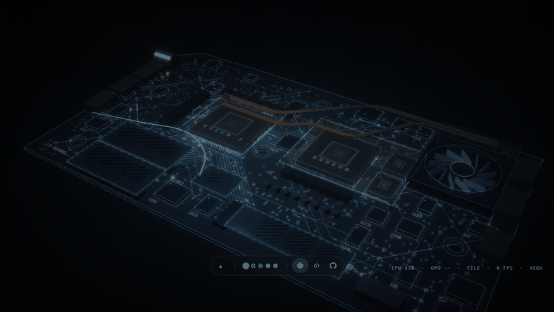

# MSI Thin Board — a Lively Wallpaper



An animated desktop wallpaper for [Lively Wallpaper](https://www.rocksdanister.com/lively/) (Windows 10 1809+ / Windows 11)
with three 3D scenes that react to your real PC:

| Scene | What you see |
|---|---|
| **Board** | A laptop motherboard. LEDs, light pulses on the copper traces, heat pipes and the fan follow your real CPU / GPU / RAM / network / battery. The chips show your own CPU and GPU names. |
| **Repos** | Your GitHub repositories as a living graph: colour = language, size = repo size, recently active repos pulse, private repos are rings. |
| **Code** | Windows of syntax-coloured code flying toward you; one of them is typed out live. You can add your own code (see below). |

Above the bar, four widget tiles: **music** (song, cover, previous / play-pause / next), **focus timer**, **battery + RAM**,
**network + disk**. Five colour themes: Ice, Amber, Jade, Violet, Graphite.

## Install
1. Drag **`MSI-Thin-Board.zip`** onto Lively's window (or **+** → choose the file), then click the wallpaper to apply it.
2. Double-click **`install.bat`** once. It finds the copy Lively made, starts the helper and makes it start with Windows
   from then on. If Windows SmartScreen asks: *More info → Run anyway*.
3. In Lively, right-click the wallpaper → **Customize** → type your **GitHub username** and pick a colour.

Check: move the mouse — the readout at the bottom right says **FILE** when the helper is running (**SIM** = demo data).
Without the helper the wallpaper still runs: demo animation, and your public repos from the username setting.

To remove: `uninstall.bat`, then delete the wallpaper in Lively. Re-run `install.bat` if you remove and add the wallpaper again.

## Controls
| Action | How |
|---|---|
| Switch scene | bar icons, or keys **1 / 2 / 3** and **← →** |
| Widgets | the **●** button or **W** (Board scene) |
| Colour theme | the dots in the bar, or **C** |
| Hide the bar | **H** |
| Quality / frame cap | **Q** / **F**, or Lively settings |
| Focus timer | click the time = start / pause, double-click = reset, **+ / −** = 5 min |

**Lively settings:** GitHub username, show private repo names, colour, animation speed, glow, show controls, quality
(Auto lowers itself when frames drop and climbs back later), FPS cap, battery saver, board activity.

**Your own code in the Code scene:** copy `snippets.example.js` to `snippets.js` in the wallpaper's folder (install.bat
prints it), edit it, reload the wallpaper. The file extension picks the colours and the badge.

## What the helper does (privacy)
A web page cannot read your hardware or music, so a small background **helper** (Windows PowerShell + a C# class it
compiles on your PC) does it and writes the data into the wallpaper's `data/` folder:

* **Reads:** CPU / GPU / RAM / battery / network / disk usage, CPU and GPU names, the song in the Windows media overlay.
* **Your repos:** looks for git clones in your user folder (4 levels deep) and reads only the text of `.git\config`
  (the repo URL). It never runs git and never reads passwords or tokens. A repo of your account that you cloned but that
  is not in your public GitHub list is shown as private — that is how private repos appear; nobody else can see them.
* **Network:** only `api.github.com`, for your public repos, at most once an hour, no login; it stops asking after
  3 refusals. Nothing is uploaded.
* **Local port** `127.0.0.1:47831` (this PC only) for the music buttons and the username setting, protected by a random
  key that changes on every start. It can only do previous / play-pause / next.
* **Writes** only inside the wallpaper folder. No admin rights needed.

## GPU tip (laptops)
Lively draws the wallpaper with the integrated GPU by default, which keeps your dedicated GPU free for games and AI
training. If the wallpaper looks dim, set **Quality = Medium** in its settings (keeps the glow, drops the costly anti-aliasing).

## Files
```
index.html, LivelyInfo.json, LivelyProperties.json, preview.*   the wallpaper (Lively needs these at the top)
install.bat / uninstall.bat      set up / remove the helper
snippets.example.js              template for your own Code-scene snippets
css/ js/ vendor/                 the page (three.js r128 in vendor/)
helper/                          the background helper (cs-load.ps1 + CsSys.cs + two worker scripts + install.ps1)
data/                            written by the helper while it runs (not in the zip)
```

---

### بالعربي باختصار
خلفية متحركة لـ Lively فيها ثلاث مشاهد: **لوحة أم** تتفاعل مع حمل جهازك الحقيقي، **مستودعاتك في GitHub**، و**نوافذ كود** طايرة.
**التثبيت:** اسحب `MSI-Thin-Board.zip` على Lively ← شغّل `install.bat` مرة وحدة ← من Customize اكتب اسم حسابك في GitHub.
الـ helper يقرا بيانات جهازك ويكتبها في مجلد الخلفية بس، وما يرسل شي لأي مكان غير طلب المستودعات العامة من GitHub.
